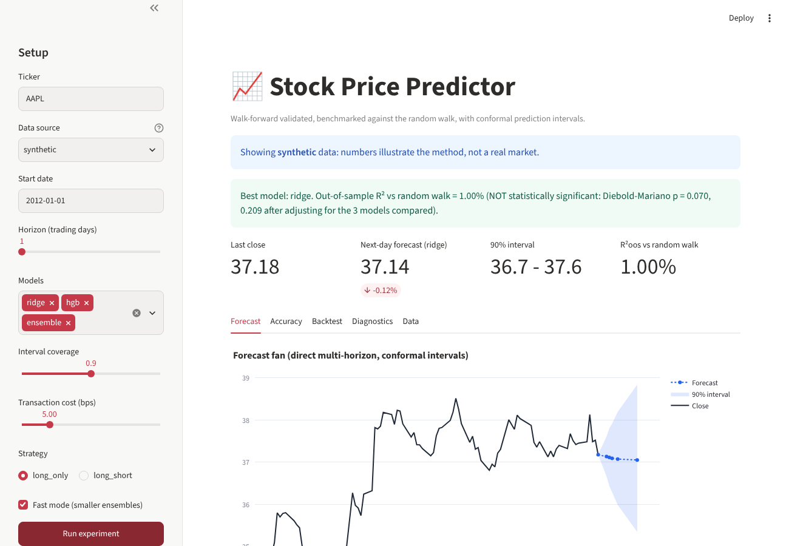

# 📈 Stock Price Predictor

**A stock forecasting system built to answer the question most tutorials skip: _does the model actually beat "tomorrow = today"?_**

Most "stock predictor" projects regress price on price, report R² ≈ 0.99, and stop. That number is an artefact: prices are non-stationary, so any model that copies yesterday's close looks brilliant. This project forecasts **returns**, validates them **walk-forward**, benchmarks every model against the **random walk**, tests significance with **Diebold-Mariano**, and wraps every forecast in a **conformal prediction interval** with guaranteed coverage.



## What makes it different

| | Typical tutorial | This project |
|---|---|---|
| Target | Raw price (non-stationary, R² ≈ 0.99 for free) | h-day log return; price derived from it |
| Validation | Random train/test split (leaks the future) | Expanding-window **walk-forward**, label-aware (no overlapping-label leakage for h > 1) |
| Baseline | None | Random walk + historical mean, on every table |
| "Is it good?" | Eyeball a chart | Out-of-sample R² vs random walk, **Diebold-Mariano test**, directional accuracy vs *chance-adjusted* hit rate |
| Uncertainty | A single line | **Volatility-normalised split-conformal intervals** (90% band → ~90% empirical coverage) |
| Selection bias | Pick the best of N, quote its score | p-values **Bonferroni-adjusted** over the models compared |
| Trading | "Sharpe 3!" | Cost-aware long/flat backtest next to buy & hold, labelled as an optimistic upper bound |
| Trust | Hope | **Leakage canary tests** (below) |

### The leakage canaries
Two tests prove the pipeline is honest rather than just claiming it:
- **Pure random walk in → no skill out.** On simulated prices with zero planted signal, no model may show significant out-of-sample skill.
- **Planted signal in → skill detected.** With a strong planted signal the pipeline must find it, so the first test isn't passing because the system is blind.

Plus a no-lookahead test (features recomputed on truncated history must be identical) and a label-observability test (a refit may never train on a label that ends after its forecast origin).

## Quickstart

```bash
pip install -e ".[dev,app]"

stockpred AAPL --models ridge,hgb,ensemble        # live data, writes reports/report.html
stockpred DEMO --source synthetic --fast           # fully offline demo
streamlit run app.py                               # interactive dashboard
pytest -q                                          # 20 tests
docker build -t stockpred . && docker run -p 8501:8501 stockpred
```

`--source auto` (default) uses Yahoo Finance and **falls back to simulated data with a loud warning** if offline. Every report is labelled with its data source. Bring your own data with `--source csv --csv prices.csv`.

## Example output (simulated data, 1,896 out-of-sample days)

| Model | RMSE (ret %) | R²oos % | Dir. acc | Chance | DM p | 90% coverage |
|---|---|---|---|---|---|---|
| naive (random walk) | 1.198 | 0.00 | - | - | - | 90.0% |
| linear (OLS) | 1.463 | **-49.1** | 50.6% | 50.1% | 1.000 | 91.4% |
| **ridge** | **1.192** | **+0.99** | 54.4% | 50.5% | 0.005 (0.024 adj.) | 89.7% |
| random forest | 1.202 | -0.60 | 53.1% | 50.4% | 0.716 | 89.9% |
| grad. boosting | 1.205 | -1.15 | 51.4% | 50.3% | 0.896 | 90.2% |
| ensemble | 1.197 | +0.31 | 53.2% | 50.4% | 0.329 | 90.2% |

> ⚠️ **Read this honestly.** This run uses *simulated* prices with a deliberately faint planted signal, because the build environment had no access to Yahoo Finance. It demonstrates that the method works and is calibrated, **not** that real markets are predictable. On real liquid stocks, expect R²oos ≈ 0 or negative, and that is exactly what this framework is designed to tell you instead of flattering you. I have not claimed any live-market result.

Things the table shows that a naive project would hide: unregularised OLS on 40 correlated features **loses 49%** to the random walk (overfitting); flexible models (RF, boosting) don't beat a regularised linear model in a low-signal-to-noise setting; and the gap between ridge's 54.4% hit rate and the 50.5% a skill-free forecaster would score is the honest edge, not "54% vs 50%".

## Method

```
prices ──► causal features (39) ──► walk-forward loop ──► metrics + significance
 (OHLCV)   momentum, vol, trend,      refit every 21 bars,    R²oos, DM test, dir. acc
           RSI/MACD/BB, bar shape,    train only on labels     │
           volume, calendar           already observable       ├─► conformal intervals
                                                               └─► cost-aware strategy backtest
```

- **Features** (`features.py`): multi-horizon momentum (incl. 12-1), realised/Parkinson/ATR volatility, SMA distance, RSI, MACD, Bollinger, stochastic, gap/intraday/close-location, volume z-scores, cyclical calendar terms. All strictly causal.
- **Models** (`models.py`): random walk, historical mean, OLS, RidgeCV (time-series CV), random forest, gradient boosting, voting ensemble. Linear models are winsorised and standardised inside the pipeline so nothing leaks from the test fold.
- **Intervals** (`backtest.py`): score = `|error| / σₜ` on past out-of-sample forecasts; band = `pred ± q·σₜ` with the finite-sample ⌈(n+1)(1-α)⌉ quantile. Bands widen in turbulent markets while staying calibrated. A rolling-coverage chart makes drift visible.
- **Multi-horizon fan** (`pipeline.forecast_fan`): a separate direct model per horizon (1-10 days) instead of recursive forecasting, so errors don't compound.
- **Diagnostics**: permutation importance on a held-out slice, error by volatility regime, calibration over time.

## Limitations (stated, not hidden)
- Backtest fills at the close with a flat bps cost; no slippage model, borrow fees or taxes. Treat results as an upper bound.
- Single instrument at a time; no portfolio construction.
- Features are price/volume only; no fundamentals, news or alternative data.
- Yahoo data is adjusted for splits/dividends but may have survivorship and revision issues.
- Educational project, **not investment advice**.

## Project layout
```
src/stockpred/  data · features · models · backtest · metrics · pipeline · viz · report · cli
app.py          Streamlit dashboard          tests/   20 tests incl. leakage canaries
Dockerfile · Makefile · .github/workflows/ci.yml
```

## Ideas to extend
LSTM/temporal-fusion baseline, cross-sectional model over a universe, regime-switching gating, a probabilistic (quantile) objective, live paper-trading via a scheduler.
